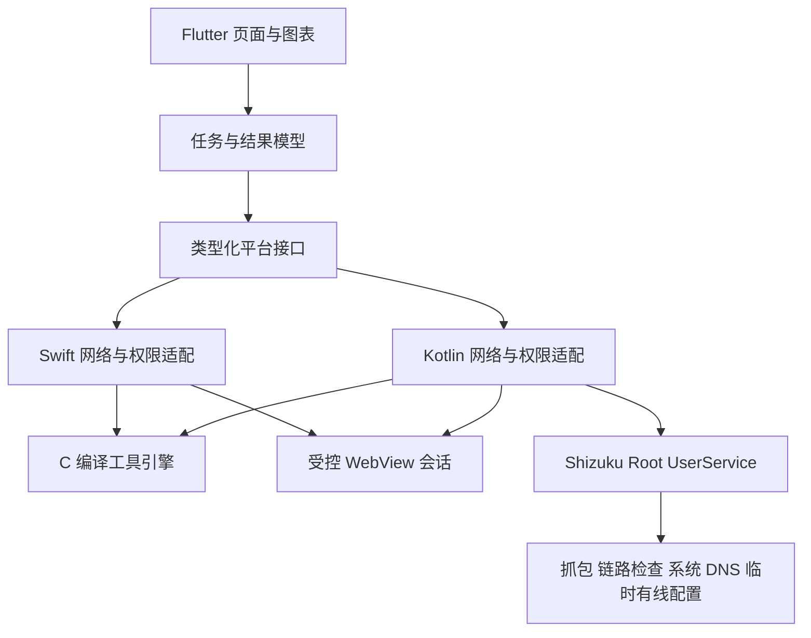

# 架构与未来目录

doc_id: A01 · 本页目录为规划，不在本轮创建代码

Flutter 层负责表单、筛选、图表、任务状态和本机结果。原生层负责权限、网络句柄、DNS、socket、任务资源。C 层负责可复用协议和测试逻辑。iOS 返回明确的能力列表，界面据此显示不支持状态，不用分叉整个应用。

Android 高级执行通过 [A05](privileged-service.md) 接入，普通 UI 进程不提升权限。配置写入另遵循 [A06](network-recovery.md)，不由 KernelSU Next / Shizuku 自动承担恢复。

| 未来目录 | 内容 | 默认 owner |
| --- | --- | --- |
| `apps/mobile/lib/app/`、`lib/design/` | 路由、主题、公共组件 | T04，之后由集成人维护 |
| `apps/mobile/lib/features/<feature>/` | 各功能 UI / 状态 | 对应 T06–T11 |
| `packages/net_contract/` | 模型、桥接 schema、生成产物 | T04 / 集成人独占 |
| `packages/net_platform/android/` | 网络、权限、原生插件 | T05；子功能目录再分 owner |
| `packages/net_platform/ios/` | Swift 能力适配 | T13 |
| `packages/net_platform/android/privileged/` | Shizuku 授权、UserService、身份与能力检查 | T15 / 集成人 |
| `native/advanced/capture/`、`link/`、`dns/`、`ethernet/` | 四项高级引擎 | T16 / T17 / T18 / T19 各自独占 |
| `apps/mobile/lib/features/advanced/<feature>/` | 高级入口、授权与各功能页面 | T15 管共享入口，T16–T19 管功能子目录 |
| `spikes/privileged/`、`docs/evidence/T14/` | KernelSU Next + Shizuku Root 验证 | T14 |
| `native/core/` | 共享接口、任务取消、socket 工厂 | T02 后移交 T04，接口修改串行 |
| `native/iperf/`、`native/probes/`、`native/dns/`、`native/telnet/` | 工具封装 | T08 / T09 / T10 |
| `native/third_party/` | 锁定源码、哈希、补丁、许可证清单 | 集成人独占清单，功能 owner 提案 |
| `packages/net_platform/android/webspeed/` | 网页测速隔离与绑定 | T11 |
| `spikes/network/`、`spikes/native/`、`spikes/webspeed/` | 开发阶段验证工程 | T01 / T02 / T03 |
| `tests/fixtures/`、`tests/integration/`、`docs/evidence/` | 受控服务、跨功能验收、脱敏证据 | T12；早期 probe 写各自子目录 |

文件夹名只是所有权边界，T04 可在不改变职责的前提下细化。修改共享契约需要先交接后生成所有平台代码。任何功能 agent 不能自行新建独立 HTTP/DNS 客户端绕开 [A03](network-context.md)。

iOS 复用的是 UI、业务模型、错误语义和 C 引擎；平台权限、网卡绑定、WebView 和后台能力必须适配。早期任务要留 iOS 构建证据入口，不以 Dart 单测替代 iOS 编译。
