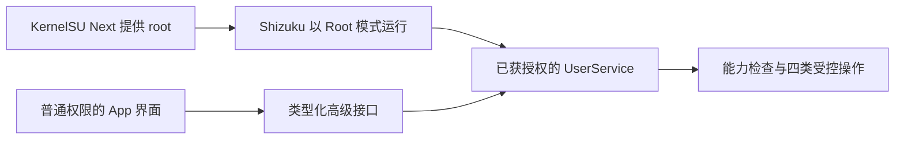

# Shizuku 高级执行边界

doc_id: A05

Shizuku 管访问授权，KernelSU Next 管 root 的提供；应用入口只引导已有环境连接，不提供 root 获取或自动刷机。普通模式独立运行；iOS 返回高级功能 unsupported。实现目录为 `packages/net_platform/android/privileged/` 和 `native/advanced/{capture,link,dns,ethernet}/`，T15 管公共边界，各功能任务只管自己的子目录。

选用的 Shizuku API 版本若默认自动初始化 Sui，应按其官方 API 显式关闭该自动路径，确保访问来自用户指定的 Shizuku；具体版本与配置由 T14/T15 核实，不静默接受另一个后端。

## 权限状态

状态分别记录：not_installed、not_running、unauthorized、shell_mode、root_ready、capability_limited、disconnected。记录 serverUid、workerUid、授权和服务 generation、能力列表及检查时间；技术身份放详情，界面默认用普通文字。root_ready 只表示执行身份，不能把所有功能自动设为 supported。

首次使用按需请求 Shizuku 授权；每次操作复核身份、服务 generation、权限和接口。Binder 死亡、授权撤销或身份变化使旧请求失效；不自动改为直接 su，也不在权限恢复后重放旧命令。UserService 只接受调用本应用的受控接口，不输出任意 shell 执行能力。

长任务的限时与存活检查在执行端实现，不只依赖 Flutter 页面。失联/撤权要停止捕获和探测并拒绝新操作；有未结束配置事务时，按 A06 尝试已批准的清理并报告真实结果。T14 要证明无遗留的无限期高权限工作进程，否则该能力不放行。

## 扩展契约

| 模型 / 操作 | 最小语义 |
| --- | --- |
| PrivilegeSnapshot | status、serverUid、workerUid、generation、featureCapabilities、checkedAt |
| InterfaceRef | ifindex、interfaceName、generation、transport、可得的设备关联信息；NetworkRef 可空 |
| RootRequest | requestId、operation、interfaceRef / networkRef、privilegeGeneration、白名单参数、到期时间 |
| CaptureSession | captureId、interfaceRef、过滤、截断长度、计数、丢包、文件状态；独立于普通 taskId |
| ConfigTransaction | transactionId、原配置、差异、接口身份、确认期限、会话期限、恢复状态；细节见 A06 |

新增操作：getPrivilegeState、probeAdvancedCapabilities、start/stopCapture、runArpCheck、observe/probeDhcp、flushSystemDns、preview/apply/confirm/restoreEthernet。拒绝未知操作、未授权调用者、非法接口、任意路径和任意命令参数。捕获文件经受控文件描述符交付本 App，由用户选择位置导出。

新增错误：SHIZUKU_UNAVAILABLE、SHIZUKU_UNAUTHORIZED、ROOT_MODE_REQUIRED、PRIVILEGE_LOST、CAPABILITY_DENIED、INTERFACE_CHANGED、CONFIG_CONFLICT、RECOVERY_PENDING。根身份验证失败不是“目标网络不通”。

无 IPv4 时抓包、ARP 地址检查和 DHCP 观察仍可通过 InterfaceRef 工作；IP 连接工具仍要求 NetworkContext。不能为了复用旧模型而把“正在等待 DHCP”的网卡排除。
