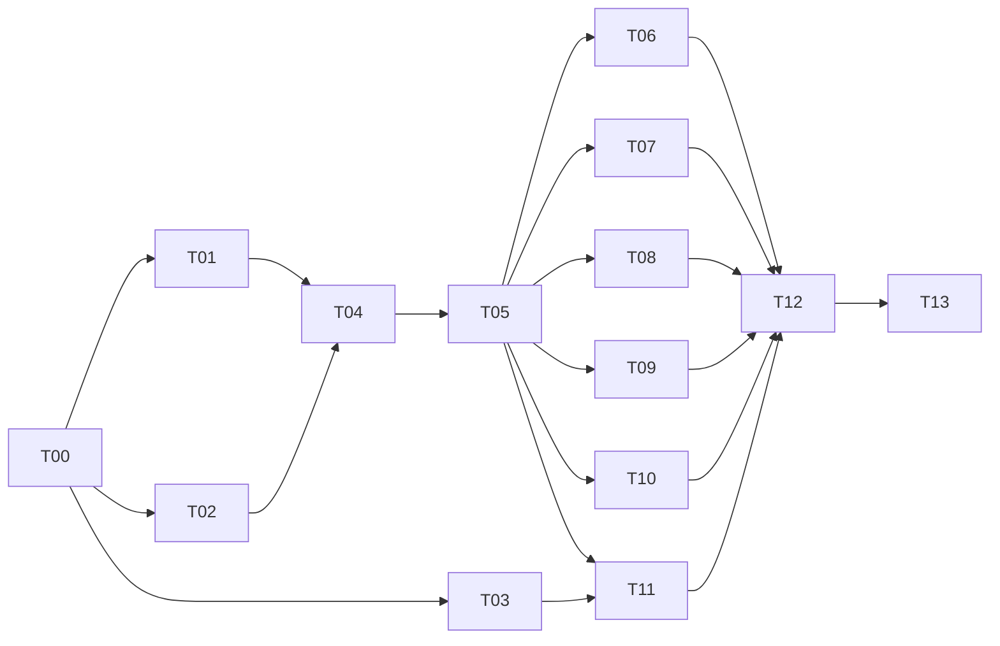
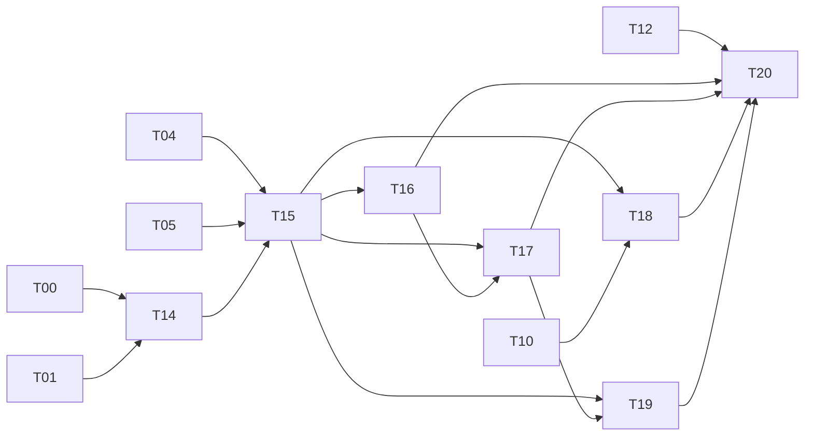

# 开发路线图

doc_id: D01 · 以下是未来开发计划，本轮不执行

| 阶段 | 任务 | 放行条件 |
| --- | --- | --- |
| M0 范围与关键验证 | T00–T03 | 明确系统限制；双网卡、原生探测、网页方案各有结论与证据 |
| M1 公共基础 | T04–T06 | 契约冻结、能力模型、网络选择、概览和公网 IP 贯通 |
| M2 核心工具 | T07–T11 | 图表、iperf3 s/c、telnet/ping/tcping/traceroute、DNS、公网网页分别验收 |
| M3A Android 普通基线 | T12 | 真机矩阵、边界、包体与资源检查、普通流程证据 |
| M3B Android 高级扩展 | T14–T20 | KernelSU Next + Shizuku Root、四项功能、撤权与恢复，T20 联合放行 |
| M4 iOS | T13 | 复用共享层；真实验证支持的功能；公开平台差异；评估发布要求 |

T01 / T02 的 iOS 轻量验证在第一阶段做，以及时发现跨端契约问题；T13 才是完整 iOS 功能交付。T03 失败不阻止独立局域网功能推进，但阻止完整一期发布，除非用户明确接受范围例外。

高级验证 T14 在 T01 后尽早启动，不等普通功能全部开发结束。依赖如下；T13 仍只依赖普通基线，不把 Android Root 能力移植为 iOS 越狱功能。

## 工作量粗估

以熟悉移动网络与 Flutter 的开发人员计，T00–T12 合计约 **43–67 人日**；加入设备兼容和系统变化的预留后约 **54–84 人日**。这是任务分解估算，尚未通过原型验证，不是承诺工期。两位开发配合测试可按约 6–10 周讨论排期；原生权限或 WebView 方案失败会改变范围和周期。iOS 完整移植另估 15–25 人日，取决于早期验证结论。

新增 T14–T20 约 **21–35 人日**，普通 + 高级合计约 **64–102 人日（未计兼容预留）**。旧的 6–10 周仅对应普通基线，不能继续当完整扩展后的工期承诺。Root 设备/ROM 适配及配置恢复的不确定性应在 T14 后重新估算。

第一批资源：至少两家 Android 真机、USB-C 网卡/有源扩展坞、可观察路由的双网络、实验 PC、可控 DNS/TCP/Telnet 服务。iOS 早期验证需要 macOS/Xcode 或 macOS CI 与真机；WSL 能做文档、Android 构建和受控 Linux 服务，不能证明 iOS 可编译运行。

高级资源增加：KernelSU Next + Shizuku Root 真实环境、可切为 ADB 模式的对照、可控 DHCP/DNS、可恢复的有线实验网和权限撤销/重启测试条件。未 Root 的对照机也必须保留。

不在本次范围：IPv6 诊断、端口扫描、全网设备发现、路由器配置、SSH、后台常驻服务、热力图地图、账号和云服务；弱网模拟、防火墙、PPPoE、VLAN、Wi-Fi monitor 也未加入。抓包与所选 USB 网卡临时配置已经明确加入高级范围，不再排除。
