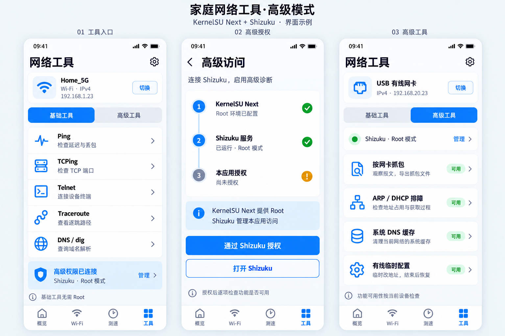
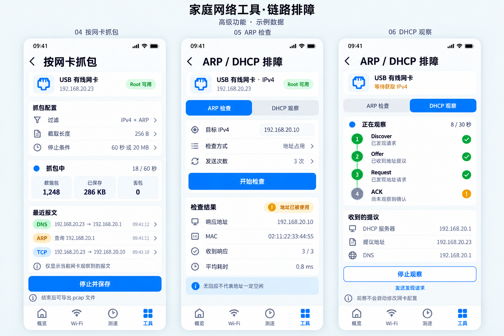
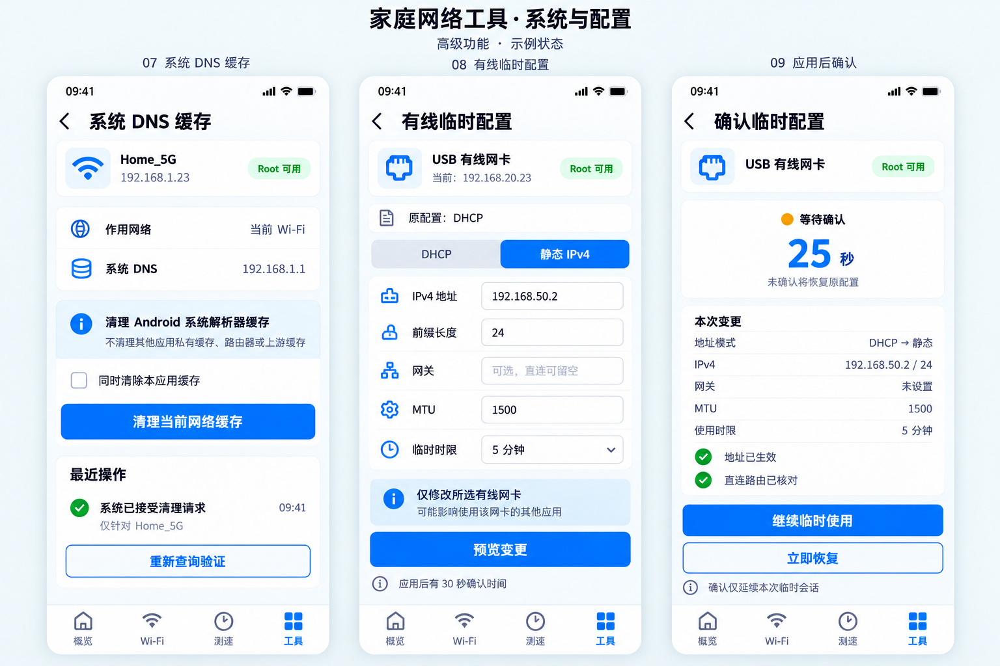
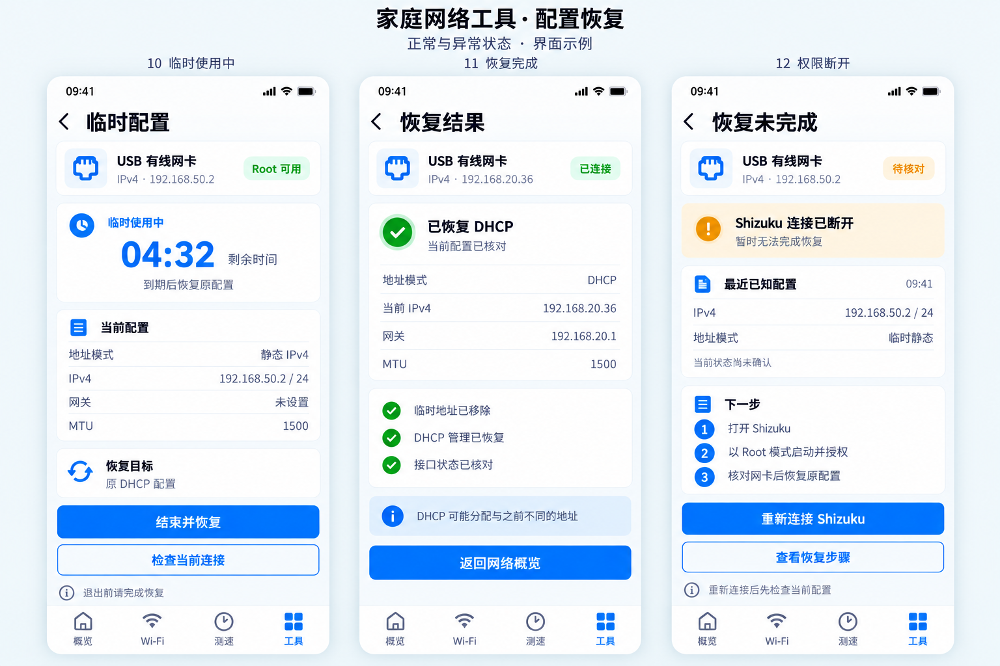

# GUI 渲染图 · 高级模式 v2

doc_id: VIS01 · 2026-10-22 · 静态视觉稿，v2 为当前高级模式方案

按 [P03 界面规划](../product/ux.md) 和 [R06 权限方案](../research/root-access.md) 重构。v2 新增四张设计板、十二个界面，保留四项底部导航，在“工具”内区分基础/高级。仍为浅灰背景、白卡和蓝色主操作；每张 1536 × 1024 PNG。

图片中的授权、能力、地址、报文和结果全部是示例状态，不代表已在 Root 手机上实现或实测。KernelSU Next 提供 root，Shizuku 以 Root 模式管理本 App 的访问；ADB 模式不能视为可用。功能细节以 F09–F12 和 A05/A06 为准，本轮没有创建应用代码。

## v2 · 01–03 工具入口、授权与高级功能

[查看原图](gui-access-v2.png) · [生成提示词](gui-access-v2.prompt.txt)

基础工具保持可用；高级访问页区分 Root 环境、Shizuku 服务与本应用授权；高级页只列本次加入的四项功能。不同屏幕为独立示例状态，不暗示尚未授权的页面同时能调用高级操作。

## v2 · 04–06 抓包、ARP 检查与 DHCP 观察

[查看原图](gui-link-v2.png) · [生成提示词](gui-link-v2.prompt.txt)

抓包保留 IPv4 + ARP 与文件上限；ARP 有回应表示地址已用，不直接写成冲突；DHCP 尚未看到 ACK 时不显示“已获取地址”。

## v2 · 07–09 系统 DNS、有线配置与确认

[查看原图](gui-config-v2.png) · [生成提示词](gui-config-v2.prompt.txt)

系统 DNS 与应用缓存分开，成功文案为系统已接受请求；有线地址先预览，应用后有 30 秒确认，继续使用也只有有限会话。

## v2 · 10–12 临时使用、已恢复与恢复未完成

[查看原图](gui-recovery-v2.png) · [生成提示词](gui-recovery-v2.prompt.txt)

“已恢复”有读回结果；DHCP 可以分配新地址。Shizuku 失联时明确显示待核对与恢复未完成，不出现假成功，也不自动改用直接 su。

## v1 基础页参考与历史稿

- [概览、Wi-Fi Channels、局域网测速](gui-core-v1.png)：基础信息层级继续参考；系统缓存与高级配置的新入口以 v2 为准。
- [Comparison、公网测速、旧工具入口](gui-features-v1.png)：前两页仍作参考，工具入口已由 v2 01–03 取代。
- [网卡选择、iperf3 服务端、普通 DNS](gui-details-v1.png)：普通功能参考；普通 DNS 的应用缓存按钮仍保留，高级系统缓存另见 v2。
- [v1 提示词](gui-prompts-v1.txt)：保留历史，不覆盖旧图。

## 生成与检查

使用内置 image_gen；v2 首张参考原工具页，其余三张沿用 v2 首张样式。每张的完整提示词见对应链接，图像保存为新版本，没有覆盖 v1。

检查重点：中文与主题一致、四项导航完整、授权链正确、只加入四项高级能力、无 IPv4 的 DHCP 观察可表达、DNS 作用范围准确、临时配置有确认/期限/恢复、权限断开不显示已恢复。渲染图不是交互测试或系统能力证明，真机验收由 T14–T20 执行。
