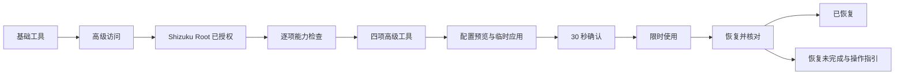
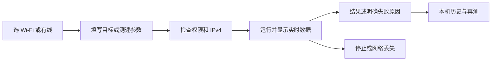

# 界面与主要流程

doc_id: P03

静态视觉参考：[GUI 渲染图 · v2](../design/README.md)，重构基础/高级工具入口，补齐授权与配置恢复状态；v1 保留作基础页参考。图片使用示例数据，功能与边界仍以本页及对应功能规格为准。

参考对象已定位为 App Store 的 **Device Lab，开发者广聪 钟，id6757624445**。本轮查看了官方商店中的概览截图：浅灰底、白色分组卡片、蓝色小标签、左右排列的名称与数值、底部导航。仅借鉴信息层级；不复制图标、文案或截图。[S02-12](../research/sources-services.md)

## 页面结构

| 页面 | 首屏内容 | 主要操作 |
| --- | --- | --- |
| 概览 | 顶部网络选择器；IPv4、网关、DNS、公网 IPv4；接口卡片 | 切换接口、刷新、复制；从网关启动 ping |
| Wi-Fi | 网络 / Comparison / Channels；频段切换；最近扫描时间 | 选 AP、过滤、暂停 / 继续、查看带宽 |
| 测速 | 局域网 / 公网；客户端 / 服务端；国内 / 国际 | 表单启动、停止；网页打开前提示会产生流量 |
| 工具 · 基础 | ping、tcping、telnet、traceroute、DNS；基础/高级页签 | 简单表单 → 运行 → 结果 → 再测 |
| 工具 · 高级 | Shizuku 状态；按网卡抓包、ARP/DHCP、系统 DNS、有线临时配置 | 检查授权 → 检查能力 → 运行；写入需预览与恢复 |

设置和本机历史从右上角进入。任何工具都显示本次使用的网络、IPv4 和状态；选中接口、系统默认接口分别标注。

## 高级访问与异常状态

保留四个底部导航，不新增第五个“Root”。工具页增加基础/高级页签；高级功能用同一蓝色视觉体系，小型状态标签区分“可用 / 待授权 / 需 Root 模式 / 当前设备不支持”。不靠大盾牌、红黑配色或终端式界面表达高级模式。

高级访问页列出 KernelSU Next 环境（配置假设）、Shizuku 服务/运行方式、本应用授权三层；主按钮按状态变为“打开 Shizuku”“通过 Shizuku 授权”“检查可用功能”。UID、SELinux 等放展开详情，普通页面只给用户可执行的下一步。ADB 模式明确提示需要 Root 模式，不显示已就绪。

无 IPv4 接口的抓包/ARP/DHCP 页面显示“等待获取 IPv4”，仍允许适用诊断。系统 DNS 页面把系统清理与应用缓存按钮分开，成功文案是“系统已接受清理请求”，不显示虚构清理条数。

有线配置流程：表单 → 变更预览 → 应用并检查 → 30 秒确认 → 有期限的临时会话 → 恢复。等待确认页使用“继续临时使用 / 立即恢复”，会话页持续显示剩余时间和“结束并恢复”。恢复完成必须有读回结果；Shizuku 失联时显示“恢复未完成”，提供“重新连接 Shizuku”和“查看恢复步骤”，不能在同页显示绿色成功勾。

## 视觉与状态规范

建议 8dp 间距体系、16dp 页面边距、12–16dp 卡片圆角；正文 14–16sp，主数值 24–32sp；触控区域至少 48dp。默认跟随系统浅/深色，蓝青色作为操作色；红、黄只用于异常。数值等宽对齐，单位始终显示。科技感来自精确图表和信息密度，不加扫描光束、3D 仪表或常驻动效。

空状态区分：未连接、无 IPv4、权限拒绝、定位关闭、扫描受限、系统不支持、服务不可达。未知值显示“不可获取 + 原因”，不写 0。图表有文本摘要和多线样式，不能只靠颜色识别。

切换网卡时，若有运行任务，先说明任务将停止，完成清理后再切换。拒绝权限后保留可用功能；从系统设置返回重新检查。窄屏、横屏、200% 字体、键盘弹起和深色都列入 [D03](../delivery/acceptance.md) 验收。
